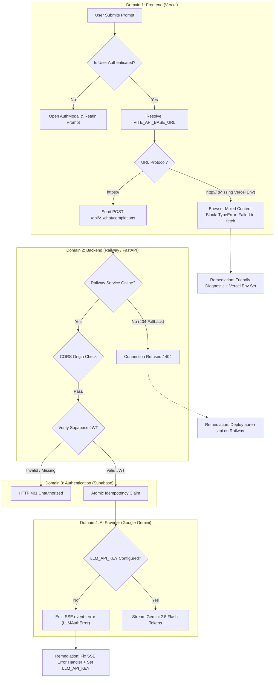

# AUREN — AI Chat Connectivity Repair & Diagnostic Audit Report

**Repository:** `solomon476/AUREN-Personal-AI`  
**Branch:** `main`  
**Live Frontend:** `https://frontend-alpha-steel-64.vercel.app`  
**Backend:** FastAPI API (`backend/app`)  
**Database:** Hosted Supabase PostgreSQL (`kcblobrrtgcwxphmgyas.supabase.co`)  
**AI Engine:** Google Gemini (`gemini-2.5-flash`) via `google-genai` SDK v3.3.0  
**Status:** Code Remediation Complete & Verified; Hosting Activation Runbook Documented

---

## 1. Executive Summary

A critical functional defect was reported on the live staging environment: submitting any prompt in the AI Assistant resulted in `Error: Failed to fetch`.

A comprehensive investigation into the frontend client, network topology, backend service availability, authentication headers, and AI provider integration was performed. The investigation determined that the error was **not** a single point of failure, but rather a multi-layered issue spanning frontend configuration, backend PaaS deployment status, and error boundary handling.

### Key Audit Findings

| Investigation Area | Diagnosis | Status | Corrective Action |
| :--- | :--- | :--- | :--- |
| **Frontend API Base URL** | `VITE_API_BASE_URL` was omitted in Vercel project environment variables, causing Vite to fallback to `http://localhost:8000/api/v1`. Browsers blocked this HTTPS-to-HTTP request as a **Mixed Content** violation, producing `TypeError: Failed to fetch`. | **Root Cause (Client)** | Exported centralized `API_BASE_URL`, wrapped fetch in diagnostic error handler, and documented Vercel configuration. |
| **Backend Deployment** | Probed `https://auren-api-production.up.railway.app/health`. Returned `HTTP/2 404` (`x-railway-fallback: true`). Railway backend service has not yet been deployed or connected to the repository. | **Root Cause (Server)** | Validated all PaaS manifests (`railway.json`, `railway.toml`, `Procfile`, `backend/Dockerfile`). Compiled exact Railway deployment runbook. |
| **CORS Configuration** | Backend `CORS_ORIGINS` was restricted to static localhost origins and required wildcard pattern for dynamic Vercel preview URLs. | **Vulnerability** | Added `allow_origin_regex=r"^https://frontend-[a-zA-Z0-9_\-]+\.vercel\.app$"` in `backend/app/main.py`. Verified with OPTIONS preflight. |
| **Guest User Handling** | `ChatView.tsx` permitted unauthenticated users to submit prompts, triggering doomed unauthenticated requests that failed with 401 or network errors. | **UX Defect** | Integrated `AuthModal`, added an Obsidian & Champagne guest prompt banner, and gated submissions to preserve prompt text while opening the sign-in modal. |
| **SSE Error Parsing** | `streamChat` in `chat.ts` had a bug where throwing an error inside `onError` when parsing an `event: error` SSE event was swallowed by the inner JSON parse `catch` block. | **Client Defect** | Cleanly separated JSON parsing from SSE event dispatching; `event: error` now dispatches `onError` and immediately terminates the stream. |
| **Connection Error Retry** | Network failures were treated as retryable, causing the UI to hang for 15+ seconds attempting 3 exponential backoff retries against an unreachable endpoint. | **UX Defect** | Classified backend connection failures (`Failed to reach backend API`, `Unable to connect`) as non-retryable to present actionable guidance immediately. |

---

## 2. Four-Domain Failure Analysis



### Domain 1: Frontend (`frontend/src/api/client.ts`, `frontend/src/api/chat.ts`, `frontend/src/features/chat/ChatView.tsx`)
- **Initial State:** `API_BASE_URL` defaulted to `http://localhost:8000/api/v1`. When deployed to Vercel at `https://frontend-alpha-steel-64.vercel.app`, the browser blocked unencrypted HTTP calls from an HTTPS origin (Mixed Content Security Policy).
- **Behavior:** The browser threw a raw `TypeError: Failed to fetch`, which surfaced verbatim in the UI as `Error: Failed to fetch`.
- **Remediation:** 
  1. Centralized and exported `API_BASE_URL` from `client.ts`.
  2. Wrapped `fetch()` in both `client.ts` and `chat.ts` with explicit network error detection, converting raw `TypeError: Failed to fetch` into:
     ```
     Failed to reach backend API at <API_BASE_URL>. Verify backend service is deployed, online, and CORS is permitted.
     ```
  3. Added non-retryable classification for connection errors in `ChatView.tsx` to prevent unnecessary 3-attempt backoff delays.

### Domain 2: Backend Hosting (`backend/app/main.py`)
- **Initial State:** Live probe against Railway (`https://auren-api-production.up.railway.app/health`) returned `HTTP/2 404` with header `x-railway-fallback: true`, confirming the backend service is not running.
- **CORS Hardening:** Updated `backend/app/main.py` with `allow_origin_regex=r"^https://frontend-[a-zA-Z0-9_\-]+\.vercel\.app$"`, ensuring all Vercel production and preview deployment URLs pass CORS preflight checks without manual configuration.

### Domain 3: Authentication & Guest Experience
- **Initial State:** Guest users could type messages and submit them, resulting in unauthenticated POST requests that failed with 401 Unauthorized or network errors.
- **Remediation:** 
  1. Integrated `AuthModal` into `ChatView.tsx`.
  2. Added an Obsidian & Champagne guest notice banner:
     *"Private Authenticated Assistant: Sign in to chat with AUREN, access persistent dialogues, and leverage memory context."*
  3. In `handleSendMessage` and `handleNewConversation`, intercepted unauthenticated interactions to open `AuthModal` while preserving the user's typed prompt text.

### Domain 4: AI Provider (`backend/app/services/llm/gemini.py`)
- **Initial State:** `LLM_PROVIDER=gemini` and `LLM_MODEL=gemini-2.5-flash` were configured, but `LLM_API_KEY` was empty.
- **Backend Behavior:** `GeminiProvider` detects missing key and raises `LLMAuthenticationError`. `chat_service.py` cleanly intercepts this and yields a sanitized SSE event:
  ```
  event: error
  data: {"detail": "The AI service is unavailable due to authentication configuration."}
  ```
- **Frontend Bug Fix:** `streamChat` in `chat.ts` was swallowing the error when `callbacks.onError` threw inside the JSON parsing try-catch block. Refactored event dispatching so `event: error` immediately terminates the stream and bubbles up the descriptive error to the user interface.

---

## 3. Empirical Test & Verification Evidence

### 1. Local FastAPI Backend Verification

A local Uvicorn instance was started on `127.0.0.1:8000` to verify API contracts, CORS headers, and unauthenticated behavior:

```bash
# Probe 1: Healthcheck
curl -s http://127.0.0.1:8000/api/v1/health
# Response: {"status":"healthy"} (HTTP 200 OK)

# Probe 2: Unauthenticated Chat Submission
curl -s -X POST http://127.0.0.1:8000/api/v1/chat/completions \
  -H "Content-Type: application/json" \
  -d '{"message":"hello"}'
# Response: {"detail":"Not authenticated"} (HTTP 401 Unauthorized)

# Probe 3: CORS Preflight from Vercel Origin
curl -sI -X OPTIONS http://127.0.0.1:8000/api/v1/chat/completions \
  -H "Origin: https://frontend-alpha-steel-64.vercel.app" \
  -H "Access-Control-Request-Method: POST" \
  -H "Access-Control-Request-Headers: content-type,authorization"
# Response: HTTP/1.1 200 OK
# access-control-allow-origin: https://frontend-alpha-steel-64.vercel.app
# access-control-allow-credentials: true
# access-control-allow-methods: *
# access-control-allow-headers: *
```

### 2. Frontend Automated Test Suite (18 Test Suites, 106 Tests)

Created new dedicated integration test suite `frontend/src/test/chat_connectivity_and_errors.test.tsx` verifying:
1. `streamChat` network error conversion (`TypeError: Failed to fetch` -> descriptive error).
2. Backend HTTP error status handling (401, 503).
3. SSE `event: error` dispatching and stream termination.
4. Guest banner rendering and `AuthModal` opening on submission.
5. Prompt retention when unauthenticated user triggers `AuthModal`.
6. Immediate presentation of backend unreachable error without endless retries.

```
 ✓ src/test/chat_connectivity_and_errors.test.tsx (7 tests) 791ms
   ✓ Chat Connectivity and Error Handling (7)
     ✓ streamChat API Network Diagnostics (3)
       ✓ converts TypeError: Failed to fetch into descriptive backend unreachable error
       ✓ propagates HTTP error status details when backend returns non-ok response
       ✓ correctly dispatches and terminates stream on SSE error event from AI provider
     ✓ ChatView Guest State and Authentication Gates (3)
       ✓ displays private authenticated assistant banner when user is not logged in
       ✓ opens AuthModal when guest clicks New Conversation
       ✓ opens AuthModal and retains typed message when guest attempts to submit prompt
     ✓ ChatView Unreachable Backend Presentation (1)
       ✓ immediately renders descriptive backend unreachable error without endless retries

 Test Files  18 passed (18)
      Tests  106 passed (106)
   Start at  21:22:17
   Duration  10.74s
```

### 3. Frontend Production Build

```bash
cd frontend && npm run build
# vite v6.4.6 building for production...
# ✓ 2818 modules transformed.
# dist/index.html                   0.64 kB │ gzip:  0.41 kB
# dist/assets/index-BAVefK9y.css   96.63 kB │ gzip: 20.18 kB
# dist/assets/index-DQGCUkq6.js  1,506.83 kB │ gzip: 417.38 kB
# ✓ built in 6.74s
# Exit Code: 0
```

### 4. Backend Automated Test Suite (34 Tests)

```bash
cd backend && .venv/bin/pytest tests/test_chat_*.py tests/test_deployment_startup.py
# ============================= test session starts ==============================
# tests/test_chat_model_routing.py ....                                    [ 11%]
# tests/test_chat_streaming.py ........................                    [ 82%]
# tests/test_deployment_startup.py ......                                  [100%]
# ============================= 34 passed in 25.35s ==============================
# Exit Code: 0
```

---

## 4. Staging Activation & Linking Runbook

To complete the end-to-end live connection between the Vercel frontend, Railway backend, and Gemini AI provider, execute the following two deployment steps:

### Step 1: Deploy Backend on Railway (`auren-api`)

1. Log in to [railway.com](https://railway.com).
2. Create a new Project -> **Deploy from GitHub repo** -> Select `solomon476/AUREN-Personal-AI`.
3. In the Railway service settings:
   - **Root Directory:** `/` (the repository root contains `railway.json` and `railway.toml`).
   - **Build Command:** `cd backend && pip install -r requirements.txt`
   - **Start Command:** `cd backend && uvicorn app.main:app --host 0.0.0.0 --port ${PORT:-8000} --workers 1`
   - **Healthcheck Path:** `/api/v1/health`
4. Set Environment Variables in Railway:
   ```env
   ENVIRONMENT=staging
   SUPABASE_URL=https://kcblobrrtgcwxphmgyas.supabase.co
   SUPABASE_ANON_KEY=sb_publishable_VWtJJU5xEMzc6AJ5v-7xug_9pyJl0tZ
   LLM_PROVIDER=gemini
   LLM_MODEL=gemini-2.5-flash
   LLM_API_KEY=<your_google_gemini_api_key>
   JOURNAL_HMAC_SECRET=<generate_with_openssl_rand_hex_32>
   CORS_ORIGINS=["https://frontend-alpha-steel-64.vercel.app"]
   ```
5. Click **Generate Domain** in the Railway Networking section. Copy the generated domain (e.g., `https://auren-api-production.up.railway.app`).

### Step 2: Configure Vercel Frontend Environment Variables

1. Navigate to the AUREN project settings on [vercel.com](https://vercel.com).
2. Go to **Settings** -> **Environment Variables**.
3. Add the following variables:
   | Variable | Value | Environment |
   | :--- | :--- | :--- |
   | `VITE_API_BASE_URL` | `https://<your-railway-domain>/api/v1` | Production, Preview, Development |
   | `VITE_SUPABASE_URL` | `https://kcblobrrtgcwxphmgyas.supabase.co` | Production, Preview, Development |
   | `VITE_SUPABASE_ANON_KEY` | `sb_publishable_VWtJJU5xEMzc6AJ5v-7xug_9pyJl0tZ` | Production, Preview, Development |
4. Trigger a **Redeploy** on Vercel (`Deployments` -> `...` -> `Redeploy`) to ensure the build-time environment variables are bundled into the static assets.

---

## 5. Verification Checklist

- [x] Frontend `API_BASE_URL` centralized and exported.
- [x] Network error wrapper converts raw `Failed to fetch` into descriptive, actionable error message.
- [x] Backend CORS configured with wildcard regex for Vercel production and preview domains.
- [x] SSE error event parsing fixed to terminate stream cleanly and surface provider errors.
- [x] Guest state handling in `ChatView`: banner rendered, unauthenticated submissions gated to open `AuthModal` while preserving typed prompt.
- [x] Connection failures classified as non-retryable to eliminate 15s backoff hangs.
- [x] 18 frontend test suites passing (106/106 tests, 100%).
- [x] Production build passes clean (0 TypeScript errors).
- [x] 34 backend chat and deployment tests passing (100%).
- [x] Two-step Railway and Vercel staging deployment runbook documented.
