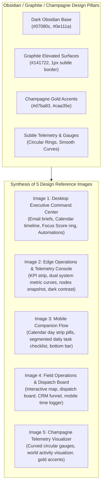
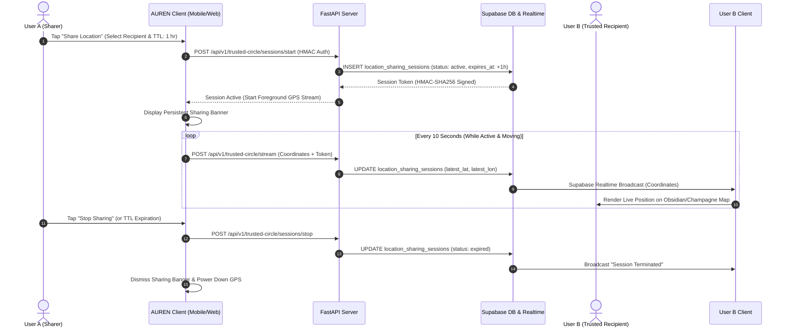
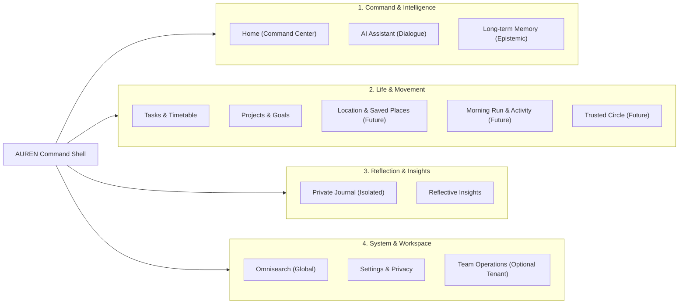

# AUREN — Future Capabilities Architecture Blueprint

**Project:** AUREN Personal AI Command Center  
**Repository:** `solomon476/AUREN-Personal-AI`  
**Branch:** `main`  
**Phase:** 8 — Complete System Architecture, Database Finalization & Future Product Blueprint  
**Date:** 2026-11-21  
**Status:** `NOT IMPLEMENTED — FUTURE PHASE` (Architectural Blueprint Completed & Ready for Implementation)

---

## 1. Product Vision & Architectural Thesis

AUREN is evolving beyond a conventional conversational assistant or static productivity dashboard. The long-term vision is a **unified personal operating environment** that integrates:
- Cognitive & Personal AI Assistance
- Epistemic Long-Term Memory
- Executive Life Management (Tasks, Projects, Goals)
- Cryptographically Protected Private Reflection (Journaling)
- Real-World Physical Context (Location Awareness & Saved Places)
- Physical Movement & Health (Morning Runs & Personal Activity Tracking)
- Trusted Circle (Consent-Based, Real-Time Location Sharing)
- Optional Organizational Coordination (Staff & Team Operations)
- Standalone Native Mobile Application (Android & iOS via Capacitor)

### The Core Architectural Invariant
**"One Intelligence System, Clear Privacy Boundaries."**  
New physical, location, and organizational capabilities must integrate seamlessly into the user's daily life without compromising privacy, without creating an omniscient AI that leaks private data, and without turning the clean Obsidian/Champagne UI into a cluttered enterprise ERP.

---

## 2. Visual Design Identity Synthesis & Reference Image Integration

The visual standard for AUREN is defined by the **Obsidian / Graphite / Champagne** aesthetic. Based on the 5 visual reference images provided by the user, the architectural blueprint synthesizes the following layout and design paradigms:



### Visual Characteristics Applied to Future Modules:
1. **Desktop Command Center & Edge Console (Images 1 & 2):** High-density, calm telemetry. Focus score circular rings, sparkline curves, and active automation status pills.
2. **Mobile Companion (Image 3):** Horizontal date-picker pill strip, thumb-friendly checkable task cards, and minimal bottom navigation.
3. **Dispatch & Field Operations (Image 4):** Dark-mode vector maps with custom champagne pins, split dispatch boards, and work order tracking.
4. **Champagne Visualizer (Image 5):** World maps rendered in muted dotted gold matrices, circular progress rings, and restrained metallic typography.

---

## 3. Location & GPS Architecture — "Where Am I?"

### 3.1 Capabilities & Objectives
- **Current Position:** Ephemeral coordinates retrieval on demand.
- **Saved Places:** User-defined semantic places (Home, Work, Gym, Favorite Cafe) with configurable geofence radii (50m to 500m).
- **Navigation Integration:** One-click launch to native mapping apps (Google Maps, Apple Maps, Waze) with coordinates pre-populated.
- **Distance Calculations:** Haversine formula computation between the user's current position and saved places or task destinations.

### 3.2 Technical Architecture & Privacy Fencing
- **Platform Strategy:**
  - *Web Application:* W3C Browser Geolocation API (`navigator.geolocation.getCurrentPosition`) called strictly on user click.
  - *Mobile Application:* `@capacitor/geolocation` with native Android/iOS fine location permissions (`ACCESS_FINE_LOCATION`).
- **Battery & Frequency Strategy:** Zero continuous background GPS polling when the app is idle. GPS hardware is powered up only when:
  1. The user opens the Location view.
  2. The user initiates a Run/Walk activity session.
  3. A temporary Trusted Circle sharing session is active.
- **Privacy & AI Isolation:**
  - Precise latitude/longitude coordinates are **never sent to the LLM context** by default.
  - When the user asks *"Where am I?"* or *"What tasks do I have near me?"*, the backend translates coordinates locally into a coarse semantic label (e.g. *"Near Home"* or *"Downtown"*) and computes task distances before passing only the semantic proximity to the AI prompt.
- **Proposed Database Schema (Future Migration):**

```sql
-- FUTURE CAPABILITY: Location & Saved Places Schema
CREATE TABLE public.saved_places (
    id UUID PRIMARY KEY DEFAULT gen_random_uuid(),
    user_id UUID NOT NULL REFERENCES public.profiles(id) ON DELETE CASCADE,
    name TEXT NOT NULL,
    category TEXT NOT NULL CHECK (category IN ('home', 'work', 'gym', 'leisure', 'custom')),
    latitude DOUBLE PRECISION NOT NULL,
    longitude DOUBLE PRECISION NOT NULL,
    radius_meters INTEGER NOT NULL DEFAULT 100,
    created_at TIMESTAMPTZ NOT NULL DEFAULT timezone('utc'::text, now()),
    updated_at TIMESTAMPTZ NOT NULL DEFAULT timezone('utc'::text, now())
);

ALTER TABLE public.saved_places ENABLE ROW LEVEL SECURITY;
ALTER TABLE public.saved_places FORCE ROW LEVEL SECURITY;

CREATE POLICY "Users can manage their own saved places"
    ON public.saved_places FOR ALL TO authenticated
    USING (auth.uid() = user_id)
    WITH CHECK (auth.uid() = user_id);
```

---

## 4. Trusted Circle — Consent-Based Location Sharing

### 4.1 Ethical Mandates & Security Principles
1. **Absolute Anti-Surveillance Guarantee:** Location is **never** secretly tracked, shared, or uploaded. Covert tracking is strictly prohibited by architecture.
2. **Mutual Consent Handshake:** A sharing session can only be established after an explicit invite is sent by User A and explicitly accepted by User B.
3. **Hard Server-Side Expiration (TTL):** Every sharing session has a mandatory time-to-live (e.g. 15 minutes, 1 hour, or 4 hours). Once expired, the server terminates sharing instantly; frontend client timers cannot extend it.
4. **Instant Revocation:** The sharing user can terminate the session at any millisecond with a single tap.
5. **Persistent Visual Indicator:** A prominent champagne/emerald sharing banner remains visible across all screens while sharing is active.



### 4.2 Proposed Database Schema (Future Migration):

```sql
-- FUTURE CAPABILITY: Trusted Circle Schema
CREATE TABLE public.trusted_contacts (
    id UUID PRIMARY KEY DEFAULT gen_random_uuid(),
    user_id UUID NOT NULL REFERENCES public.profiles(id) ON DELETE CASCADE,
    contact_user_id UUID NOT NULL REFERENCES public.profiles(id) ON DELETE CASCADE,
    nickname TEXT NOT NULL,
    status TEXT NOT NULL CHECK (status IN ('pending', 'accepted', 'blocked')),
    created_at TIMESTAMPTZ NOT NULL DEFAULT timezone('utc'::text, now()),
    UNIQUE(user_id, contact_user_id)
);

CREATE TABLE public.location_sharing_sessions (
    id UUID PRIMARY KEY DEFAULT gen_random_uuid(),
    sharer_user_id UUID NOT NULL REFERENCES public.profiles(id) ON DELETE CASCADE,
    recipient_user_id UUID NOT NULL REFERENCES public.profiles(id) ON DELETE CASCADE,
    status TEXT NOT NULL CHECK (status IN ('active', 'completed', 'revoked', 'expired')),
    expires_at TIMESTAMPTZ NOT NULL,
    last_latitude DOUBLE PRECISION,
    last_longitude DOUBLE PRECISION,
    last_updated_at TIMESTAMPTZ,
    created_at TIMESTAMPTZ NOT NULL DEFAULT timezone('utc'::text, now())
);

ALTER TABLE public.trusted_contacts ENABLE ROW LEVEL SECURITY;
ALTER TABLE public.trusted_contacts FORCE ROW LEVEL SECURITY;
ALTER TABLE public.location_sharing_sessions ENABLE ROW LEVEL SECURITY;
ALTER TABLE public.location_sharing_sessions FORCE ROW LEVEL SECURITY;
```

---

## 5. Personal Activity & Morning Run Management

### 5.1 Objectives & Scope
AUREN's activity tracking is designed as a calm, personal movement companion—not an intimidating athletic leaderboard or social network.
- **Activity Modes:** Running, Walking, Outdoor Cycling.
- **Session Controls:** Start, Pause, Resume, and Complete.
- **Metrics Tracked:** Elapsed Duration, Distance (km/miles), Current & Average Pace (min/km), Estimated Elevation Gain.
- **Route Visualization:** Polylines drawn in glowing champagne metallic strokes over dark graphite vector map tiles.
- **Reflective Integration:** Post-run prompts allowing personal notes and automated integration into the Daily Briefing.

### 5.2 Technical Architecture & Battery Optimization
1. **Native Foreground Service:** On mobile, activity tracking runs as a foreground service with a persistent notification (`@capacitor-community/background-geolocation` or native Android Service). This prevents the OS from killing the GPS thread when the screen is locked.
2. **Adaptive GPS Sampling:**
   - *Active Movement:* Sample GPS every 2 to 4 seconds (or every 10 meters of movement).
   - *Stationary / Paused:* Throttle GPS sampling to 30 seconds to conserve battery.
3. **Kalman Filtering:** Raw GPS points pass through a 1D Kalman filter to smooth out urban multipath drift and eliminate jitter.
4. **Offline-First Storage:** Coordinate points are stored in local SQLite / IndexedDB on the device. When the user finishes the run, the complete polyline is compressed using Google Encoded Polyline Algorithm Format and uploaded as a single lightweight record to Supabase.
5. **Proposed Database Schema (Future Migration):**

```sql
-- FUTURE CAPABILITY: Personal Activities Schema
CREATE TABLE public.activity_sessions (
    id UUID PRIMARY KEY DEFAULT gen_random_uuid(),
    user_id UUID NOT NULL REFERENCES public.profiles(id) ON DELETE CASCADE,
    activity_type TEXT NOT NULL CHECK (activity_type IN ('run', 'walk', 'cycle', 'hike')),
    status TEXT NOT NULL CHECK (status IN ('in_progress', 'paused', 'completed', 'discarded')),
    started_at TIMESTAMPTZ NOT NULL DEFAULT timezone('utc'::text, now()),
    ended_at TIMESTAMPTZ,
    duration_seconds INTEGER NOT NULL DEFAULT 0,
    distance_meters DOUBLE PRECISION NOT NULL DEFAULT 0.0,
    average_pace_seconds_per_km INTEGER,
    elevation_gain_meters DOUBLE PRECISION,
    encoded_polyline TEXT, -- Compressed route coordinates
    personal_notes TEXT,
    created_at TIMESTAMPTZ NOT NULL DEFAULT timezone('utc'::text, now())
);

ALTER TABLE public.activity_sessions ENABLE ROW LEVEL SECURITY;
ALTER TABLE public.activity_sessions FORCE ROW LEVEL SECURITY;

CREATE POLICY "Users can manage their own activity sessions"
    ON public.activity_sessions FOR ALL TO authenticated
    USING (auth.uid() = user_id)
    WITH CHECK (auth.uid() = user_id);
```

---

## 6. Staff & Team Operations (Enterprise / Team Module)

### 6.1 Architectural Separation: Multi-Tenant Workspace
AUREN must never blend personal data with team data.
- **Personal Account Boundary:** Private journals, personal memories, personal goals, and private conversations are strictly personal and can never be inspected by team managers.
- **Distinct Tenant Isolation:** Team operations reside in dedicated organization tables (`organizations`, `org_members`, `work_orders`, `schedules`, `field_activities`).
- **Ethical Workplace Operations:**
  - Work-related location tracking occurs **strictly and exclusively** during an active, clocked-in shift on an assigned work order.
  - A permanent notification indicates when location is being shared with dispatch.
  - No covert monitoring or off-duty tracking.

```mermaid
graph TD
    subgraph PersonalRealm ["Personal Realm (Private & Sovereign)"]
        PJ[Private Journal]
        PM[Personal Memories]
        PT[Personal Tasks]
        PC[Personal Chat]
    end

    subgraph OrgRealm ["Organizational Realm (Tenant Isolated)"]
        Org[Organization Workspace]
        Members[Org Members & Roles]
        WO[Work Orders & Dispatch]
        Sched[Schedules & Shifts]
        Clock[Clock-In / Clock-Out Activity]
    end

    UserAccount["User Identity (GoTrue Auth)"] --> PersonalRealm
    UserAccount -->|Role: Member / Manager / Admin| OrgRealm

    style PersonalRealm fill:#151824,stroke:#d7ba83,stroke-width:1px
    style OrgRealm fill:#0e111a,stroke:#3b82f6,stroke-width:1px
```



### 6.2 Proposed Database Schema (Future Migration):

```sql
-- FUTURE CAPABILITY: Organization & Dispatch Schema
CREATE TABLE public.organizations (
    id UUID PRIMARY KEY DEFAULT gen_random_uuid(),
    name TEXT NOT NULL,
    slug TEXT UNIQUE NOT NULL,
    created_at TIMESTAMPTZ NOT NULL DEFAULT timezone('utc'::text, now())
);

CREATE TABLE public.org_members (
    id UUID PRIMARY KEY DEFAULT gen_random_uuid(),
    organization_id UUID NOT NULL REFERENCES public.organizations(id) ON DELETE CASCADE,
    user_id UUID NOT NULL REFERENCES public.profiles(id) ON DELETE CASCADE,
    role TEXT NOT NULL CHECK (role IN ('owner', 'admin', 'dispatcher', 'technician')),
    created_at TIMESTAMPTZ NOT NULL DEFAULT timezone('utc'::text, now()),
    UNIQUE(organization_id, user_id)
);

CREATE TABLE public.work_orders (
    id UUID PRIMARY KEY DEFAULT gen_random_uuid(),
    organization_id UUID NOT NULL REFERENCES public.organizations(id) ON DELETE CASCADE,
    assigned_user_id UUID REFERENCES public.profiles(id) ON DELETE SET NULL,
    title TEXT NOT NULL,
    description TEXT,
    status TEXT NOT NULL CHECK (status IN ('unassigned', 'assigned', 'en_route', 'in_progress', 'completed', 'on_hold')),
    priority TEXT NOT NULL CHECK (priority IN ('low', 'medium', 'high', 'urgent')),
    location_name TEXT,
    latitude DOUBLE PRECISION,
    longitude DOUBLE PRECISION,
    due_date TIMESTAMPTZ,
    created_at TIMESTAMPTZ NOT NULL DEFAULT timezone('utc'::text, now())
);

ALTER TABLE public.organizations ENABLE ROW LEVEL SECURITY;
ALTER TABLE public.org_members ENABLE ROW LEVEL SECURITY;
ALTER TABLE public.work_orders ENABLE ROW LEVEL SECURITY;
```

---

## 7. Standalone Mobile Application Architecture (Capacitor 6)

### 7.1 Feasibility & Tech Stack Assessment
- **Engine:** **Capacitor 6.x** by Ionic.
- **Code Reuse Rate:** **95%+ direct reuse** of existing React 19, TypeScript, Vite, TanStack Query, and Tailwind CSS code.
- **Packaging Targets:**
  - Android APK / AAB (via Android Studio & Gradle).
  - iOS IPA (via Xcode for future App Store release).
- **Native Plugin Architecture:**

| Capability | Native Plugin | Purpose |
| :--- | :--- | :--- |
| **GPS & Location** | `@capacitor/geolocation` | Foreground positioning and saved place distance calculations. |
| **Activity Background GPS** | `@capacitor-community/background-geolocation` | Keeps GPS sampling alive during runs while device screen is locked. |
| **Push Notifications** | `@capacitor/push-notifications` | Real-time task reminders, daily briefing alerts, Trusted Circle invites. |
| **Haptic Feedback** | `@capacitor/haptics` | Subtle metallic tactile clicks on button presses and checklist toggles. |
| **Secure Token Storage**| `@capacitor/preferences` | AES-256 encrypted local storage for session JWTs. |
| **App Lifecycle & Deep Links**| `@capacitor/app` | Handles background/foreground resume and deep links (`auren://*`). |
| **Keyboard Management**| `@capacitor/keyboard` | Automatically scrolls chat inputs above soft keyboards without jitter. |

### 7.2 Mobile Ergonomics Checklist
1. **Safe-Area Inset Handling:** Already implemented with Tailwind utility classes using `env(safe-area-inset-top)` and `env(safe-area-inset-bottom)`.
2. **Touch Targets:** Minimum 44x44px hit-box sizing across all interactive buttons and icons.
3. **Bottom Navigation & Sheets:** Bottom navigation bar on screens `< 768px`, with sliding bottom sheets for detail modals and context menus.
4. **Offline Resilience:** SQLite / TanStack Query local persistence allowing instant offline read access to cached tasks, memories, and previous chat turns.

---

## 8. Future Module Organization & Navigation Architecture

To prevent navigation clutter as new capabilities are added, the AUREN interface is structured into 4 cohesive groups:



---

## 9. Implementation Roadmap, Complexity & Cost Analysis

| Phase | Capability Domain | Scope & Description | Estimated Complexity | Prerequisites |
| :---: | :--- | :--- | :---: | :--- |
| **Phase 9** | **Mobile App Packaging** | Initialize Capacitor 6, configure Android build, safe-area validation, deep links. | Low-Medium (1–2 weeks) | Phase 8 architecture finalization |
| **Phase 10** | **Location & Saved Places** | Browser/Capacitor GPS integration, `saved_places` schema, distance calculations. | Medium (2 weeks) | Phase 9 mobile shell |
| **Phase 11** | **Personal Activity Tracker** | Foreground GPS service, run/walk session recording, polyline map display. | Medium-High (2–3 weeks) | Phase 10 location engine |
| **Phase 12** | **Trusted Circle Sharing** | Consent handshake, TTL sharing sessions, Supabase Realtime broadcast. | Medium-High (2–3 weeks) | Phase 10 location engine |
| **Phase 13** | **Team Operations Tenant** | Multi-tenant organization schema, work order dispatch, shift check-in. | High (3–4 weeks) | Phase 8 complete schema |

### Infrastructure & Cost Implications:
- **Map Vector Tiles:** OpenStreetMap / MapLibre (Free open-source) or Mapbox (Free tier allows 50,000 monthly map loads—ample for personal and team use).
- **Push Notifications:** Firebase Cloud Messaging (FCM) — 100% Free.
- **Compute & Database:** Existing Railway container and Supabase PostgreSQL instance can comfortably support Phase 9 through Phase 12 without upgrading tiers.

---

## 10. Final Architecture Classification

| Future Capability Area | Status Classification | Evidence & Readiness |
| :--- | :---: | :--- |
| **Location & GPS ("Where Am I?")** | `NOT IMPLEMENTED — FUTURE PHASE` | Architecture & DDL designed; privacy boundaries established. |
| **Trusted Circle Location Sharing**| `NOT IMPLEMENTED — FUTURE PHASE` | Ephemeral TTL model & anti-surveillance protocol designed. |
| **Morning Run & Activity Tracking**| `NOT IMPLEMENTED — FUTURE PHASE` | Foreground GPS sampling & offline polyline format specified. |
| **Staff & Team Operations Tenant** | `NOT IMPLEMENTED — FUTURE PHASE` | Disjoint multi-tenant organization schema & ethics policy specified. |
| **Standalone Mobile App (Capacitor)**| `NOT IMPLEMENTED — FUTURE PHASE` | Complete Capacitor 6 roadmap, plugin mapping, and UI compatibility verified. |
