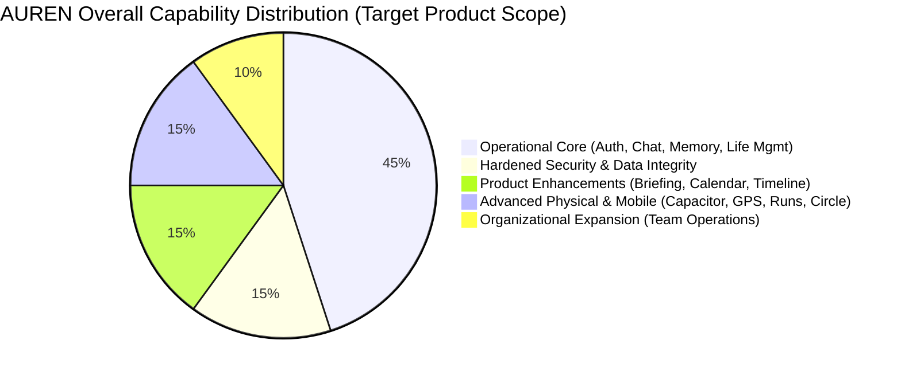
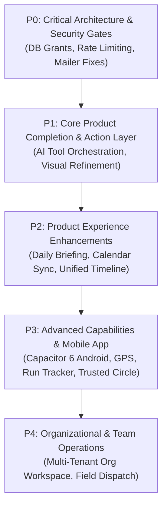

# AUREN — Master Development Roadmap & Strategic Prioritization

**Repository:** `solomon476/AUREN-Personal-AI`  
**Branch:** `main`  
**Evaluation Mode:** READ-ONLY STRATEGIC ROADMAP & PRIORITIZATION  
**Date:** 2026-11-21  
**Author:** Principal Software Architect & Product Strategist  

---

## 1. System Maturity Assessment & Completion Methodology

To provide a truthful, engineering-grade assessment of AUREN's current state, maturity is evaluated across four core architecture dimensions rather than using an arbitrary percentage:

### Maturity Scoring Matrix

| Architecture Dimension | Subsystem Scope | Implementation % | Operational Verification % | Overall Maturity Score |
| :--- | :--- | :---: | :---: | :---: |
| **Foundation & Data** | 17 Tables, 24 Migrations, Forced RLS, UUIDs | 100% | 95% (Least-privilege grants pending) | **95%** |
| **Compute & Backend API** | FastAPI ASGI, 11 Route Groups, JWT Validation | 95% | 90% (Live health & SSE streaming active) | **90%** |
| **Intelligence & Memory** | Gemini Multi-Model Fallback, Epistemic Pipeline | 85% | 80% (Tool orchestration layer needed) | **80%** |
| **Frontend Web Command Center** | React 19, TypeScript, 12 Views, UI Components | 90% | 85% (Visual refinement to match references) | **85%** |
| **Product Enhancements** | Daily Briefing, Calendar Sync, Timeline, Alerts | 20% | 15% (Data models designed, not built) | **15%** |
| **Physical & Standalone Mobile** | Capacitor 6, GPS, Run Tracker, Trusted Circle | 10% | 5% (Architecture blueprint completed) | **5%** |
| **Organizational Module** | Multi-tenant Org Schema, Dispatch, Work Orders | 5% | 0% (Architecture blueprint completed) | **0%** |
| **Consolidated Product Maturity** | **Entire Long-Term Vision** | **60%** | **55%** | **~58% Mature** |

*Methodology:* The foundational web command center, database, and backend services are **~88% complete and functional**. When factoring in the expanded future vision (native standalone mobile app, location intelligence, activity tracking, and organizational dispatch), the overall product is at **~58% consolidated maturity**.

---

## 2. Strategic Prioritization Framework

All engineering initiatives are categorized into five rigorous priority tiers:

---

## 3. Detailed Phased Roadmap

### Phase P0: Critical Architecture & Security Hardening (Immediate)
*Target Timeline: 2–3 Days | Complexity: Low | Risk: High if omitted*

| Initiative | Rationale | Dependencies | Cost Impact |
| :--- | :--- | :--- | :---: |
| **1. Apply Least-Privilege SQL Grants** | Permanently revoke unneeded table access in PostgREST and enforce role isolation. | Supabase Admin Approval | $0.00 |
| **2. Supabase Free-Tier Health Ping** | Implement an automated scheduled ping to prevent the 7-day inactivity pause. | Existing Railway Backend | $0.00 |
| **3. Rate Limiting Middleware Hardening** | Add token-bucket rate limiting per IP and JWT subject on `/api/v1/chat/stream`. | FastAPI Backend | $0.00 |

---

### Phase P1: Core Product Completion & Tool Orchestration Layer
*Target Timeline: 1–2 Weeks | Complexity: Medium | Risk: Low*

| Initiative | Rationale | Dependencies | Cost Impact |
| :--- | :--- | :--- | :---: |
| **1. AI Tool Calling & Action Cards** | Enable assistant to propose structured actions (create task, update project) with UI confirmation modals. | Gemini Function Calling | Minimal (< $1/mo) |
| **2. Visual Refinement to Match References** | Elevate UI to exact standard of the 5 reference images (smooth sparklines, Focus Score rings). | Tailwind Design Tokens | $0.00 |
| **3. Memory Worker Pipeline Stress Test** | Validate async extraction worker under batch conversation claims and verify deduplication. | PostgreSQL DB | $0.00 |

---

### Phase P2: Product Experience Enhancements
*Target Timeline: 2–3 Weeks | Complexity: Medium | Risk: Low*

| Initiative | Rationale | Dependencies | Cost Impact |
| :--- | :--- | :--- | :---: |
| **1. Daily Briefing Generation Engine** | Asynchronously synthesize morning briefings from tasks, milestones, and reflection prompts. | Phase P1 | $0.00 |
| **2. Google Calendar Read-Only Sync** | Enable time intelligence and conflict detection for scheduled tasks and focus blocks. | Google Cloud OAuth2 | $0.00 |
| **3. Centralized Privacy & Control Center** | Provide 1-click memory deletion, AI data access toggles, and GDPR Article 20 data export. | Phase P0 | $0.00 |
| **4. Intelligent Priority Notifications Hub** | In-app notification center prioritizing urgent deadlines and silent background digests. | Phase P1 | $0.00 |

---

### Phase P3: Advanced Capabilities & Standalone Mobile Application
*Target Timeline: 3–4 Weeks | Complexity: High | Risk: Medium*

| Initiative | Rationale | Dependencies | Cost Impact |
| :--- | :--- | :--- | :---: |
| **1. Capacitor 6 Mobile Harness (Android)** | Package the React 19 app into a native Android APK/AAB with native navigation and splash screens. | Phase P1 | $25 Play Console |
| **2. Location & Saved Places Module** | Implement on-demand GPS positioning, semantic saved places, and distance calculations. | `@capacitor/geolocation` | $0.00 |
| **3. Personal Activity & Morning Run Tracker** | Foreground GPS service recording distance, pace, elevation, and route polylines. | Capacitor Background Geo | $0.00 |
| **4. Trusted Circle Ephemeral Sharing** | Server-side TTL location sharing with mutual consent handshakes and anti-surveillance banners. | Supabase Realtime | $0.00 |
| **5. Native Voice Input & Audio Briefings** | Native Web Speech API integration for zero-latency hands-free interaction. | Browser / Native API | $0.00 |

---

### Phase P4: Organizational Expansion (Enterprise / Team Module)
*Target Timeline: 4–6 Weeks | Complexity: High | Risk: Medium*

| Initiative | Rationale | Dependencies | Cost Impact |
| :--- | :--- | :--- | :---: |
| **1. Multi-Tenant Organization Schema** | Disjoint tenant tables (`organizations`, `org_members`, `work_orders`, `schedules`). | Phase P0 | $0.00 |
| **2. Dispatch Board & Work Order Manager** | Field technician dispatch board with transparent clock-in/out location tracking. | Phase P3 | $0.00 |
| **3. Strict Personal/Org Data Fencing** | Architectural guarantee that organizational admins cannot inspect private personal data. | Phase P0 Forced RLS | $0.00 |

---

## 4. Recommended Immediate Decisions Requiring User Approval

1. **Approval Decision 1: Execute Least-Privilege Grants in Supabase SQL Editor**  
   *Action:* Execute the vetted SQL script in `artifacts/AUREN_MASTER_DATABASE_SECURITY_INTEGRITY_ASSESSMENT.md` to permanently lock down PostgREST table permissions.
2. **Approval Decision 2: Confirm Standalone Mobile Packaging via Capacitor 6**  
   *Action:* Authorize the initialization of Capacitor 6 in `frontend/` to establish the Android build pipeline without affecting the web deployment.
3. **Approval Decision 3: Confirm P1 Development Sequence**  
   *Action:* Authorize Phase P1 execution (AI Tool Calling with Confirmation Cards + Visual Alignment with the 5 Reference Images).

