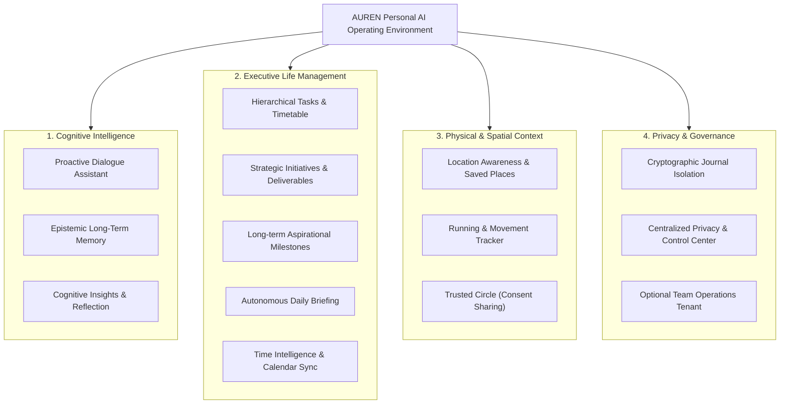
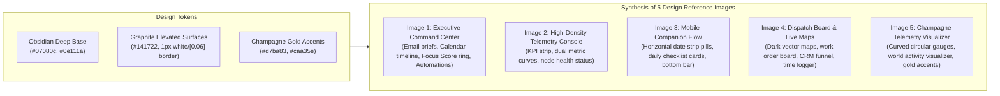

# AUREN — Master Product Vision & Future Capabilities Blueprint

**Repository:** `solomon476/AUREN-Personal-AI`  
**Branch:** `main`  
**Evaluation Mode:** READ-ONLY PRODUCT VISION & CAPABILITY ARCHITECTURE BLUEPRINT  
**Date:** 2026-11-21  
**Status:** `NOT IMPLEMENTED — FUTURE PHASE` (Architectural Blueprint Completed & Ready for Implementation)  
**Author:** Principal Product Architect & Systems Engineer  

---

## 1. Product Vision & Architectural Thesis

AUREN is evolving beyond a conventional conversational bot or static task tracker. The long-term vision is an **autonomous, quiet, and hyper-personalized operating environment** designed to elevate the user's daily cognitive and physical execution:

### The Invariant Core Principle
**"One Cohesive System, Strict Domain Privacy Boundaries."**  
The addition of physical context, organizational workflows, and proactive briefings must not turn AUREN into an unmanageable enterprise ERP, nor create an unconstrained AI that leaks private reflections across modules.

---

## 2. Visual Design Standard & Reference Image Integration

The visual standard of AUREN is defined by the **Obsidian / Graphite / Champagne** aesthetic. Through the synthesis of the 5 visual reference images provided by the user, the future UI incorporates the following design pillars:

### Visual Characteristics Applied to Future Capabilities:
- **Calm, High-Density Telemetry:** Curved progress rings for the daily Focus Score, sparkline activity curves, and quiet status badges.
- **Mobile Ergonomics:** Horizontal date-picker pill strips (Image 3), thumb-friendly checkable task cards, bottom sheets with drag handles, and bottom navigation.
- **Spatial Maps:** Dark-mode vector tiles accented with glowing champagne polyline routes and metallic destination pins (Images 4 & 5).

---

## 3. Daily Briefing Capability

### 3.1 Architectural Scope
The Daily Briefing is not an ungrounded hallucinated chat message. It is an **asynchronously generated, deterministic executive digest** synthesized from actual database records:
- **P0 Priorities:** Top 3 high-priority tasks due today.
- **Time Commitments:** Upcoming calendar meetings and time blocks.
- **Project Alerts:** Any linked projects with overdue milestones or blocked tasks.
- **Physical Context:** Today's weather forecast and planned morning run or workout session.
- **Cognitive Prompt:** One relevant reflection thought surfaced from confirmed memories.

### 3.2 Generation & Caching Strategy
- **Generation Trigger:** Generated via a scheduled background worker job at 06:00 user local time, or synthesized on-demand upon first app open of the day.
- **Persistence:** Stored in the `public.briefings` table with a daily unique constraint `(user_id, date)`.
- **UI Placement:** Displayed as the hero card on the Home Command Center, collapsible into an audio brief.

---

## 4. Calendar & Time Intelligence

### 4.1 Integration Architecture
AUREN avoids rebuilding a bespoke calendar from scratch. Instead, it adopts a **provider-independent calendar sync architecture**:
1. **Initial Phase (P2):** Read-only synchronization with Google Calendar via OAuth2 (storing calendar events in `public.calendar_events`).
2. **Time Intelligence Engine:** The backend computes available focus blocks between scheduled meetings, automatically suggesting optimal time windows for pending high-priority tasks.
3. **Conflict Detection:** When the user or assistant proposes scheduling a task or event, the system validates against existing commitments and warns of overlapping blocks.
4. **AI Access Boundary:** The assistant receives only start time, end time, and event title. Meeting descriptions and attendee lists are excluded by default to preserve contact privacy.

---

## 5. Unified Personal Timeline

### 5.1 Architecture: Event Sourcing & Derived Views
AUREN adopts a hybrid timeline model:
- **Core Entities Remain Sovereign:** Tasks, projects, activity runs, and journal reflections stay in their respective normalized tables.
- **Materialized Event Feed:** A read-only event stream aggregates completed tasks, milestone completions, activity sessions, and reflections into a unified chronological feed.
- **Privacy Gating:** Journal reflection events on the public timeline display only a discrete timestamp and a generic label (e.g. *"Private Reflection Logged"*); reflection body text is cryptographically hidden behind the user's master biometric or session unlock.

---

## 6. Intelligent Priority-Based Notifications

### 6.1 Noise Reduction & Priority Matrix
AUREN must never spam the user with frivolous alerts. Every notification must pass a multi-level priority gate:

| Priority Level | Category | Delivery Channel | Quiet Hours Override? | Example |
| :--- | :--- | :--- | :---: | :--- |
| **P0 — Urgent** | Imminent deadlines, Trusted Circle alerts | Push + In-App Banner | Yes (Emergency bypass) | "Trusted contact requested location handshake." |
| **P1 — High** | Daily morning brief, scheduled task alerts | Push + Notification Hub | No (Respects sleep schedule) | "09:00 Focus Block: Complete System Audit." |
| **P2 — Normal** | Project milestone reached, memory candidate extracted | Notification Hub Only | No | "AI extracted 2 new candidate memories for review." |
| **P3 — Low** | Weekly reflective insights available | In-App Badge | No | "Weekly reflection synthesis is ready." |

---

## 7. Centralized Privacy & Control Center

### 7.1 User Sovereignty Dashboard
Located within Settings, the Privacy & Control Center provides complete transparency over AUREN's internal data state:
1. **Epistemic Memory Browser:** Complete inventory of confirmed, candidate, and archived memories with 1-click deletion or outdating.
2. **AI Data Access Toggles:** Fine-grained switches controlling whether the assistant can access tasks, projects, calendar, or location context.
3. **Journal Isolation Verification:** Displays the HMAC signature status and confirms that zero journal entries are included in standard AI prompts.
4. **Data Portability:** 1-click JSON export of all user-owned data (profiles, tasks, projects, memories, journals) adhering to GDPR Article 20.
5. **Right to Be Forgotten:** Complete account and data deletion executing cascading drops across all 17 database tables.

---

## 8. GPS & Location Intelligence — "Where Am I?"

### 8.1 On-Demand Positioning & Saved Places
- **Device Location:** Retrieved strictly on explicit user action via the W3C Geolocation API (Web) or `@capacitor/geolocation` (Mobile).
- **Saved Places:** User-defined places (Home, Work, Gym) with configurable geofence radii (100m to 500m).
- **Navigation Integration:** Deep-linking to external mapping providers (Google Maps, Apple Maps, Waze) with coordinates pre-populated.
- **Privacy Boundary:** The assistant translates coordinates locally into coarse semantic zones (*"Near Work"*) before passing prompt context, ensuring precise latitude and longitude are never sent to external LLMs.

---

## 9. Trusted Circle — Consent-Based Location Sharing

### 9.1 Zero-Surveillance Architecture
1. **Explicit Mutual Handshake:** Location sharing requires an explicit bilateral invitation between registered AUREN users.
2. **Server-Side Time-to-Live (TTL):** Every sharing session is bounded by a strict duration (15m, 1h, 4h). Once elapsed, the database automatically revokes access.
3. **Instant Revocation:** Sharer can terminate sharing at any moment with a single click.
4. **Prominent Sharing Indicator:** A persistent banner remains visible on both web and mobile clients during active sharing sessions, guaranteeing that location can never be shared covertly.
5. **Realtime Broadcast:** Coordinates stream directly via Supabase Realtime (WebSockets) to the recipient's client without permanent location history logging.

---

## 10. Personal Activity & Morning Run Management

### 10.1 Running & Movement Architecture
- **Modes:** Running, Outdoor Walking, Cycling.
- **Metrics Tracked:** Elapsed Time, Distance (km/miles), Current & Average Pace (min/km), Elevation Gain.
- **Mobile Foreground Execution:** Runs as an Android/iOS foreground service with a persistent notification banner, preventing the mobile OS from terminating the GPS thread when the device is locked.
- **Adaptive GPS Sampling:** 2-second sampling interval during active movement, throttled to 30 seconds when stationary to conserve battery.
- **Offline Polyline Storage:** Route coordinates are cached locally on device and compressed into Google Encoded Polyline format upon completion before syncing to `public.activity_sessions`.

---

## 11. Staff & Team Operations (Enterprise / Team Module)

### 11.1 Multi-Tenant Separation & Workplace Ethics
- **Strict Data Isolation:** Personal AUREN data (journal, personal tasks, private memories) is completely inaccessible to organizational members. Personal and Organization records maintain disjoint RLS contexts.
- **Tenant Schema:** Dedicated organization tables (`organizations`, `org_members`, `work_orders`, `schedules`).
- **Ethical Dispatch:** Location sharing for field technicians occurs **strictly during clocked-in shifts** on active work orders. No off-duty or covert monitoring is permitted by the system architecture.

---

## 12. Standalone Mobile Application Architecture

- **Packaging Engine:** Capacitor 6 wrapping the existing React 19 + TypeScript + Vite frontend.
- **Code Reuse Rate:** 95%+ direct reuse of components, TanStack Query logic, and Tailwind styling.
- **Target OS:** Android APK/AAB first, with future iOS compatibility preserved.
- **Native Plugins:** `@capacitor/geolocation`, `@capacitor-community/background-geolocation`, `@capacitor/push-notifications`, `@capacitor/preferences`, `@capacitor/app`, `@capacitor/haptics`, `@capacitor/keyboard`.

---

## 13. Voice & Natural Interaction

- **Voice Input:** Native Web Speech API (`webkitSpeechRecognition`) for zero-latency local speech-to-text in browsers and mobile webviews; cloud Whisper API fallback for complex accents.
- **Voice Synthesis:** Native Web Speech Synthesis (`SpeechSynthesisUtterance`) utilizing premium local system voices for reading Daily Briefings.
- **Microphone Privacy:** Audio streams are processed in memory and never persisted to disk or cloud storage.

---

## 14. Offline & Resilience Architecture

- **Local Storage Engine:** IndexedDB (via TanStack Query persist client) on web, native SQLite via `@capacitor-community/sqlite` on mobile.
- **Offline Capabilities:** Instant offline access to previously loaded tasks, projects, memories, and chat history; local drafting of journal entries and offline run recording.
- **Sync & Conflict Resolution:** Optimistic UI updates with client-side timestamp reconciliation; conflicts resolve in favor of the latest server-validated update.

---

## 15. AI Reliability, Trust & Action Confirmation

AUREN must never fabricate actions or deceive the user:
1. **Explicit Epistemic Tagging:** The assistant explicitly tags responses based on provenance: `[Retrieved Memory]`, `[Calendar Commitment]`, `[General Inference]`.
2. **Two-Phase Action Confirmation:** When an AI dialogue prompts an action (e.g. creating a task or rescheduling a meeting), the system renders a structured **Action Proposal Card** with explicit *"Confirm"* and *"Cancel"* buttons. Actions are never executed silently.
3. **Audit Trail:** Every completed tool action logs an entry in `admin_maintenance_audit_log` detailing caller, timestamp, and parameters.

---

## 16. Cost & Infrastructure Projections

| Infrastructure Tier | Service Provider | Current Known Cost | Scaling Cost (100–1,000 Users) | Optimization Strategy |
| :--- | :--- | :---: | :---: | :--- |
| **Frontend CDN** | Vercel Edge | $0.00 (Hobby/Free) | $20.00 / mo (Pro) | Static asset edge caching; KaTeX chunking. |
| **Backend Compute** | Railway Cloud | ~$5.00 / mo | $10.00 – $25.00 / mo | Container sleep on idle; async worker pooling. |
| **Database & Vector**| Supabase Managed | $0.00 (Free Tier) | $25.00 / mo (Pro Tier) | Avoids 7-day pause; HNSW index pruning. |
| **AI LLM Inference** | Google Cloud AI | ~$1.00 – $5.00 / mo | $15.00 – $50.00 / mo | Routing to `gemini-3.5-flash-lite` (low cost/token). |
| **Vector Embeddings**| text-embedding-004 | < $0.50 / mo | $2.00 / mo | 768-dim embeddings; cache identical strings. |
| **Vector Map Tiles** | MapLibre / OpenStreetMap | $0.00 (Open Source) | $0.00 (Self-hosted tiles) | Mapbox free tier (50k loads) or open tiles. |
| **Push Notifications**| Firebase Cloud Messaging | $0.00 (Free Tier) | $0.00 (Unlimited Free FCM)| Native Android/iOS push notifications. |
| **Total Monthly Cost**| **Consolidated Architecture**| **~$6.00 – $10.00 / mo** | **~$72.00 – $122.00 / mo** | **High financial sustainability.** |

