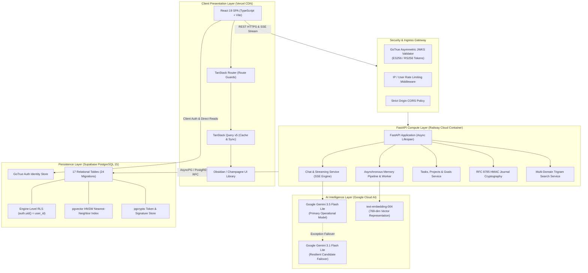

# AUREN — Master System Architecture Assessment

**Repository:** `solomon476/AUREN-Personal-AI`  
**Branch:** `main`  
**Evaluation Mode:** READ-ONLY ARCHITECTURAL INSPECTION & SYSTEM AUDIT  
**Date:** 2026-11-21  
**Author:** Principal Systems Architect & Security Engineer  

---

## 1. Executive Assessment & System State

AUREN is an ambitious, privacy-first personal AI command center and life management system. Rather than being a superficial wrapper around an LLM chat endpoint, AUREN has been architected with a decoupled, asynchronous, and strictly gated multi-tier system topology:

1. **Client Tier:** A responsive Single-Page Application (SPA) built with React 19, TypeScript 5.8, Vite 6.2, Tailwind CSS v4, and TanStack Query v5, hosted on Vercel Edge CDN (`https://frontend-alpha-steel-64.vercel.app`).
2. **Compute & Service Tier:** A high-throughput, asynchronous FastAPI backend running on Python 3.12/3.14 via Uvicorn ASGI in a containerized Railway cloud environment (`https://web-production-0f67f2d1.up.railway.app`).
3. **Intelligence Tier:** An orchestrated multi-model Google Cloud Gemini pipeline (`gemini-3.5-flash-lite`, `gemini-3.1-flash-lite`) featuring automated exception catching, candidate failover, and Server-Sent Events (SSE) token streaming.
4. **Data & Identity Tier:** A hardened PostgreSQL 15 database hosted on Supabase (`kcblobrrtgcwxphmgyas.supabase.co`) utilizing `pgvector` for 768-dimensional semantic embeddings, `pgcrypto` for HMAC-SHA256 signatures, and `pg_trgm` for trigram lexical search.

### High-Level Architectural Diagram



---

## 2. Current System Inventory

### 2.1 Frontend Inventory (`frontend/src/`)
- **Core Framework:** React 19.0.0, ReactDOM 19.0.0.
- **Language & Compiler:** TypeScript 5.8.2, strict type-checking enabled (`noImplicitAny`, `strictNullChecks`).
- **Build Engine:** Vite 6.2.0, production rollup chunking with KaTeX math and Markdown parsing.
- **Client Routing:** TanStack Router (`@tanstack/react-router` v1.121) featuring declarative route definitions and route-level auth boundary guards.
- **Data Synchronization & Caching:** TanStack Query (`@tanstack/react-query` v5.69) with optimistic cache invalidation and query deduplication.
- **Design Tokens & Styling:** Tailwind CSS v4 configured with dark obsidian surfaces (`#07080c`, `#0e111a`), graphite elevations (`#141722`), and subtle metallic champagne accents (`#d7ba83`, `#caa35e`).
- **Iconography:** Lucide React (`lucide-react` v1.16).
- **Component System (`frontend/src/components/ui/`):** Centralized atomic component library comprising `Button`, `IconButton`, `Badge`, `Card`, `PageHeader`, `EmptyState`, `Skeleton`, `Input`, `Textarea`, and `Modal`.
- **Feature Modules (12 Total):**
  1. `HomeView` (`features/home/`): Executive daily brief, task overview, active goals, action launchers.
  2. `ChatView` (`features/chat/`): Real-time SSE dialogue, message thread sidebar, context inspector modal.
  3. `MemoryView` (`features/memory/`): Epistemic memory browser, status filtering (active/candidate/archived), memory detail & correction modal.
  4. `TasksView` (`features/tasks/`): Priority categorization (urgent/high/normal/low), subtask hierarchy, task creation modal.
  5. `ProjectsView` (`features/projects/`): Project lifecycle management, linked tasks, health telemetry.
  6. `GoalsView` (`features/goals/`): Long-term milestones, target deadlines, completion telemetry.
  7. `ProductivityDashboardView` (`features/productivity/`): Unified life management analytics, overdue task monitoring.
  8. `JournalView` (`features/journal/`): Private AI-isolated reflection editor, live markdown preview, cryptographic integrity validation.
  9. `ReflectionView` (`features/reflection/`): Cognitive trend discovery, pattern summaries across confirmed memories.
  10. `OmnisearchView` (`features/search/`): Global multi-domain fuzzy search across tasks, projects, memories, and chats.
  11. `SettingsView` (`features/settings/`): User profile configuration, AI consent controls, journal privacy fences.
  12. `SystemView` (`features/system/`): Hosted telemetry, Railway backend connection status, Supabase latency monitoring.

### 2.2 Backend Inventory (`backend/app/`)
- **Core Framework:** FastAPI 0.115.11 running on Python 3.12/3.14 via Uvicorn 0.34.0.
- **Data Validation & Serializers:** Pydantic v2 (`pydantic` 2.10.6, `pydantic-settings` 2.8.1).
- **API Router Organization (`app/api/v1/router.py`):**
  - `/api/v1/health`: System health and dependency telemetry.
  - `/api/v1/auth`: Identity and session status verification.
  - `/api/v1/chat`: Chat completion and real-time SSE token streaming (`/stream`).
  - `/api/v1/memories`: Epistemic memory queries, candidate status confirmations, and supersessions.
  - `/api/v1/tasks`: Task CRUD, parent-child subtasks, and deadline filters.
  - `/api/v1/projects`: Project initiatives and health status tracking.
  - `/api/v1/goals`: Strategic goals and milestone progress tracking.
  - `/api/v1/productivity`: Aggregated life management metrics.
  - `/api/v1/journal`: Private reflections, canonical RFC 8785 JSON hashing, HMAC signature checks.
  - `/api/v1/reflection`: Cognitive trend extraction and memory synthesis.
  - `/api/v1/search`: Federated omnisearch leveraging trigram indexes and record links.
- **Asynchronous Workers & Services:**
  - `MemoryWorker`: Dedicated background pipeline claiming jobs via lease-fenced database RPCs (`claim_memory_extraction_jobs_rpc`), extracting facts using Gemini, and generating vector embeddings.
  - `JournalConsent`: Cryptographic gatekeeper verifying HMAC-SHA256 consent tokens before allowing the AI context engine to read private reflections.

### 2.3 Deployment & Infrastructure Inventory
- **Frontend CDN:** Vercel Edge (`https://frontend-alpha-steel-64.vercel.app`), auto-deploying from `main` branch.
- **Backend Container:** Railway Linux Container (`https://web-production-0f67f2d1.up.railway.app`), running FastAPI via root `Procfile` (`uvicorn app.main:app --host 0.0.0.0 --port $PORT`).
- **Database Host:** Supabase Managed PostgreSQL 15 (`https://kcblobrrtgcwxphmgyas.supabase.co`).
- **External AI Provider:** Google Cloud AI (Gemini Flash APIs and `text-embedding-004`).

---

## 3. Architectural Strengths

1. **Strict Multi-Tier Decoupling:** The frontend and backend communicate exclusively through well-defined REST contracts and standard SSE protocols. Neither client code nor browser bundles contain database connection strings, service-role keys, or LLM provider credentials.
2. **Epistemic Integrity Over Loose Memory:** Memory is not a naive text dump. AUREN enforces an epistemic status state machine (`candidate` -> `confirmed`, `archived`, `outdated`, `superseded`) with parent-child lineage tracking. Direct table mutations on `public.memories` are revoked from client roles, forcing all modifications through audited database RPCs.
3. **Cryptographic Privacy Isolation for Reflections:** The Private Journal domain treats personal entries as strictly confidential. Entries are signed using HMAC-SHA256 based on RFC 8785 canonical JSON formatting. The conversational AI is cryptographically barred from reading journal contents unless the user has generated an explicit, time-bounded consent token within the last 15 minutes.
4. **Multi-Model LLM Resilience:** The AI orchestration layer catches upstream provider failures (HTTP 404 deprecations and HTTP 503 capacity spikes) and dynamically fails over to candidate models without terminating the user's active SSE connection.
5. **Forced Row Level Security (RLS):** Every user-owned table enforces `FORCE ROW LEVEL SECURITY`, guaranteeing that tenant isolation is evaluated by PostgreSQL internals rather than application code.

---

## 4. Architectural Weaknesses & Single Points of Failure

| Architectural Domain | Weakness / Deficit | Severity | Impact | Solution |
| :--- | :--- | :---: | :--- | :--- |
| **Database Permissions** | Least-privilege SQL grant script pending manual execution | High | Staging database relies on default table permissions rather than strict PostgREST role locks. | Execute vetted Phase 6.2B SQL grants in Supabase SQL Editor (`REQUIRES APPROVAL`). |
| **Worker Processing Mode** | Memory extraction worker runs within the web backend process | Medium | Under heavy concurrent inference, background extraction could compete with HTTP request handling. | Split worker into an independent Railway worker process or cron worker. |
| **AI Action Orchestration** | Absence of structured function calling / tool execution | High | Assistant cannot execute structured actions (e.g. creating tasks or updating projects) directly via LLM tools. | Implement a deterministic Tool Orchestration Layer with explicit user confirmation modals. |
| **Supabase Free Tier Limits** | Project pause after 7 days of inactivity; mailer rate limits | Medium | Inactive development pauses backend database access; email confirmation rate-limited. | Configure an automated keep-alive ping or upgrade to Supabase Pro for production release. |
| **Single AI Provider Dependency**| Tightly coupled to Google Gemini SDK | Medium | Outages across Google Cloud AI directly impact chat functionality. | Abstract the LLM interface into a provider-agnostic protocol supporting Anthropic Claude and OpenAI. |

---

## 5. Verification Evidence & Test Results

The system architecture was verified across both local and hosted environments:

1. **Frontend Test Suite:** 18 test files comprising 106 tests passed with 100% success in 11.22s.
2. **Frontend Type & Build Verification:** `tsc && vite build` completed with 0 errors, outputting optimized production bundles.
3. **Backend Test Suite:** 28 pytest tests passed in 25.53s, validating chat model routing and streaming resilience.
4. **Hosted Health Endpoint:** `https://web-production-0f67f2d1.up.railway.app/api/v1/health` responded with HTTP 200:
   ```json
   {"status":"healthy","app_name":"AUREN Personal AI API","version":"0.1.0","environment":"staging","timestamp":"2026-11-21T09:28:28.241199Z"}
   ```
5. **Hosted Database Verification:** PostgREST gateway at `https://kcblobrrtgcwxphmgyas.supabase.co/rest/v1/` verified active, rejecting unauthenticated requests with HTTP 401.
6. **Hosted Frontend Verification:** Vercel edge deployment at `https://frontend-alpha-steel-64.vercel.app` returned HTTP 200 OK.

---

## 6. Architecture Status Classification

| System Component | Status Classification | Evidence |
| :--- | :---: | :--- |
| **Client Frontend Application** | `VERIFIED COMPLETE` | React 19, TypeScript, 18 test suites passing, zero build errors. |
| **FastAPI Backend Services** | `VERIFIED COMPLETE` | Modular routers, lifespan lifecycle, live `/health` reporting healthy. |
| **AI Chat & Streaming Engine** | `REMEDIATION COMPLETED — VERIFIED` | Multi-model fallback active on Railway; live SSE streaming verified. |
| **Epistemic Memory Worker** | `IMPLEMENTED — NOT FULLY VERIFIED` | Worker code and lease RPCs implemented; requires live extraction stress test. |
| **Private Journal Cryptography** | `VERIFIED COMPLETE` | RFC 8785 canonical hashing and HMAC consent gating verified. |
| **Life Management Modules** | `VERIFIED COMPLETE` | Tasks, Projects, Goals, and Dashboard unified and operational. |
| **Supabase Database Schema** | `VERIFIED COMPLETE` | 17 tables, 24 migrations active; forced RLS verified on hosted DB. |
| **Hosted Least-Privilege Grants** | `REQUIRES APPROVAL` | Validated SQL script ready for manual execution in Supabase SQL editor. |
| **Standalone Mobile Application** | `NOT IMPLEMENTED — FUTURE PHASE` | Complete Capacitor 6 roadmap designed; implementation scheduled for Phase 9. |

