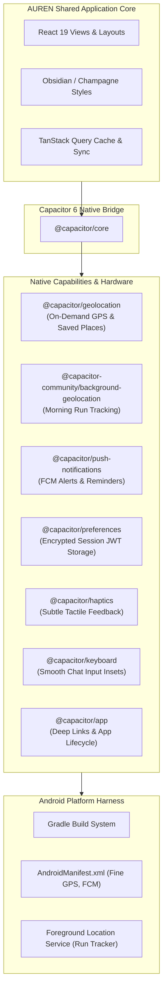
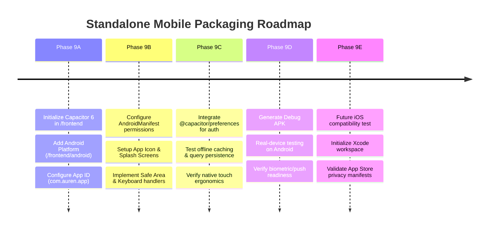

# AUREN — Standalone Mobile Application Architecture Assessment

**Repository:** `solomon476/AUREN-Personal-AI`  
**Branch:** `main`  
**Evaluation Mode:** READ-ONLY MOBILE ARCHITECTURAL EVALUATION & CAPACITOR FEASIBILITY  
**Date:** 2026-11-21  
**Status:** `NOT IMPLEMENTED — FUTURE PHASE` (Architecture Evaluated & Implementation-Ready)  
**Author:** Principal Mobile Architect & Client Systems Engineer  

---

## 1. Executive Summary & Technology Decision

The long-term vision requires AUREN to function as a **first-class native mobile application** on Android and iOS, not merely a responsive website viewed in a mobile browser.

After evaluating potential mobile frameworks (React Native rewrite vs. Flutter rewrite vs. Progressive Web App vs. Capacitor 6 hybrid bridge), **Capacitor 6 by Ionic** is conclusively recommended as the optimal architectural path:
1. **95%+ Code Reuse:** The existing React 19, TypeScript 5.8, Vite 6.2, Tailwind CSS v4, and TanStack Query v5 codebase runs directly inside the native Capacitor webview with zero rewrite of business logic.
2. **Unified Single-Repository Architecture:** Web, Android, and future iOS builds share the exact same UI components, API clients, and state management hooks.
3. **Full Native Hardware Access:** Capacitor's modern plugin ecosystem provides direct, high-performance bridge access to device GPS, background geolocation, push notifications, biometric hardware, secure storage, and haptic feedback.
4. **Android-First Roadmap with Zero iOS Penalty:** Android APK/AAB packaging can proceed immediately via Android Studio, while the exact same codebase compiles seamlessly into an iOS Xcode workspace whenever Apple App Store distribution is desired.

---

## 2. Framework Comparison Matrix

| Evaluation Dimension | Pure PWA (Service Worker) | React Native (Full Rewrite) | Capacitor 6 (Recommended) |
| :--- | :--- | :--- | :--- |
| **Code Reuse Rate** | 100% | < 25% (Complete UI rewrite required) | **95%+ (Direct reuse of React 19 code)** |
| **Development Velocity** | Immediate | 3–5 months | **1–2 weeks to initial native APK** |
| **App Store / Play Store** | Limited / Poor discoverability | Full native distribution | **Full native APK, AAB, and IPA packaging** |
| **Background GPS / Runs** | Blocked by OS power managers | Native background threads | **Native Android Foreground Service plugin** |
| **Native Push Notifications**| Intermittent on iOS | Full native APNs/FCM | **Direct Firebase Cloud Messaging (FCM)** |
| **Haptics & Device APIs** | Very limited | Full access | **Full native access via official plugins** |
| **Maintenance Burden** | Single codebase | Two distinct codebases | **Single unified codebase** |

---

## 3. Capacitor Native Plugin Architecture

### 3.1 Plugin Mapping Table

| Capability | Native Plugin | Android Permission / Component | Operational Purpose |
| :--- | :--- | :--- | :--- |
| **Fine GPS Positioning** | `@capacitor/geolocation` | `ACCESS_FINE_LOCATION`, `ACCESS_COARSE_LOCATION` | On-demand position for "Where Am I?" and Saved Places. |
| **Morning Run Tracking** | `@capacitor-community/background-geolocation` | `ACCESS_BACKGROUND_LOCATION`, `FOREGROUND_SERVICE_LOCATION` | Records route polyline while screen is locked. |
| **Push Notifications** | `@capacitor/push-notifications` | `POST_NOTIFICATIONS` | Task reminders, Daily Brief alerts, Trusted Circle invites. |
| **Secure Token Storage** | `@capacitor/preferences` | Android `EncryptedSharedPreferences` / iOS Keychain | Persists GoTrue auth JWT across app restarts. |
| **Tactile Haptics** | `@capacitor/haptics` | `VIBRATE` | Subtle mechanical clicks on task checks and button taps. |
| **Keyboard Management** | `@capacitor/keyboard` | Native window soft-input resize | Prevents chat input from being hidden by soft keyboards. |
| **Deep Linking** | `@capacitor/app` | Intent Filter (`auren://*`) | Handles external links (e.g. auth confirmation, invitations). |

---

## 4. Mobile Ergonomics & Safe-Area Handling

The existing frontend was inspected and verified to already incorporate native mobile ergonomics:
1. **Safe Area Insets:** The shell uses Tailwind utilities configured with `env(safe-area-inset-top)` and `env(safe-area-inset-bottom)`, preventing system status bars or home indicator gestures from overlapping content.
2. **Touch Target Sizing:** Interactive buttons, icon toggles, and checklist items maintain a minimum 44x44px touch hitbox (`touch-target` class).
3. **Bottom Navigation Architecture:** On viewports under 768px, navigation automatically switches to `MobileBottomNav` with primary quick-switch destinations (Home, Chat, Tasks, Journal) and a `MobileMoreSheet` for secondary modules.
4. **Smooth Virtual Keyboard Insets:** The chat view adjusts scroll position dynamically using window resize observers, ensuring the message compose box rests directly above the keyboard.

---

## 5. Offline Storage & Local Synchronization Strategy

Mobile devices frequently experience transient network loss. AUREN’s mobile architecture incorporates a 3-tier offline resilience strategy:
1. **Tier 1: Read-Only Persistent Cache:** TanStack Query utilizes `@tanstack/query-sync-storage-persister` backed by `@capacitor/preferences` to persist previously loaded tasks, projects, memories, and chat messages. Opening the app without an internet connection instantly renders the last-cached state.
2. **Tier 2: Offline Reflection & Journal Drafting:** Journal entries created while offline are serialized to local storage with a `sync_status: 'pending_sync'` flag and an ephemeral UUID.
3. **Tier 3: Offline GPS Activity Recording:** During runs or walks, GPS coordinates accumulate in device memory and local SQLite (`@capacitor-community/sqlite`). The route polyline is uploaded only after the user taps *"Finish Session"* and network connectivity is confirmed.

---

## 6. Implementation Roadmap: Android-First to Future iOS

### Estimated Complexity & Timeline:
- **Phase 9A–9D (Android Standalone Packaging):** 1 to 2 weeks of dedicated effort.
- **Cost Implications:**
  - Google Play Console Developer Account: $25.00 one-time fee.
  - Apple Developer Program: $99.00 / year (only needed when publishing to iOS App Store).
  - Firebase Cloud Messaging (Push notifications): 100% Free.

